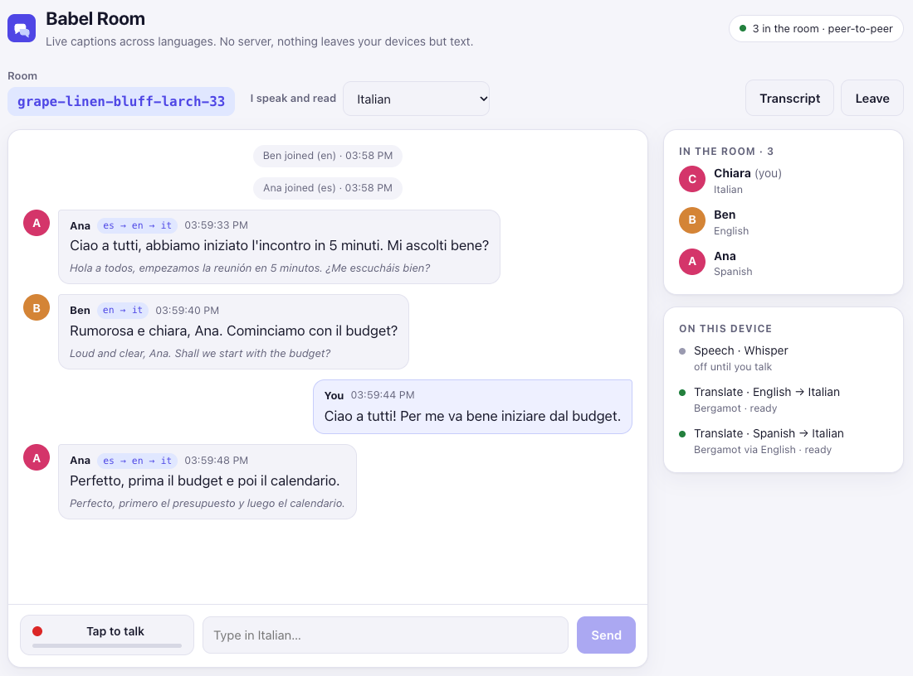
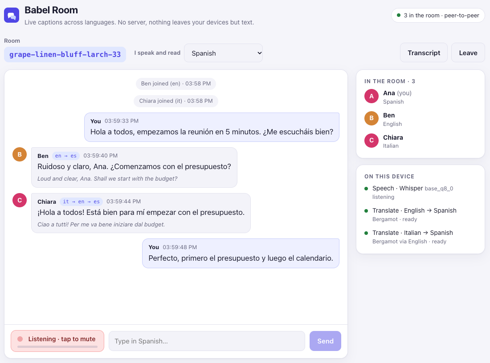
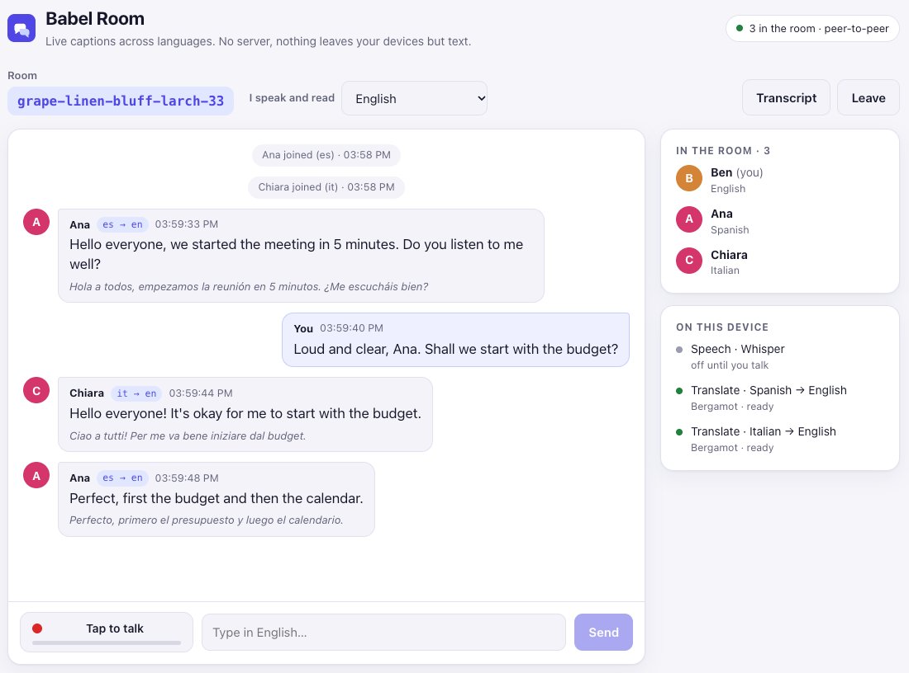
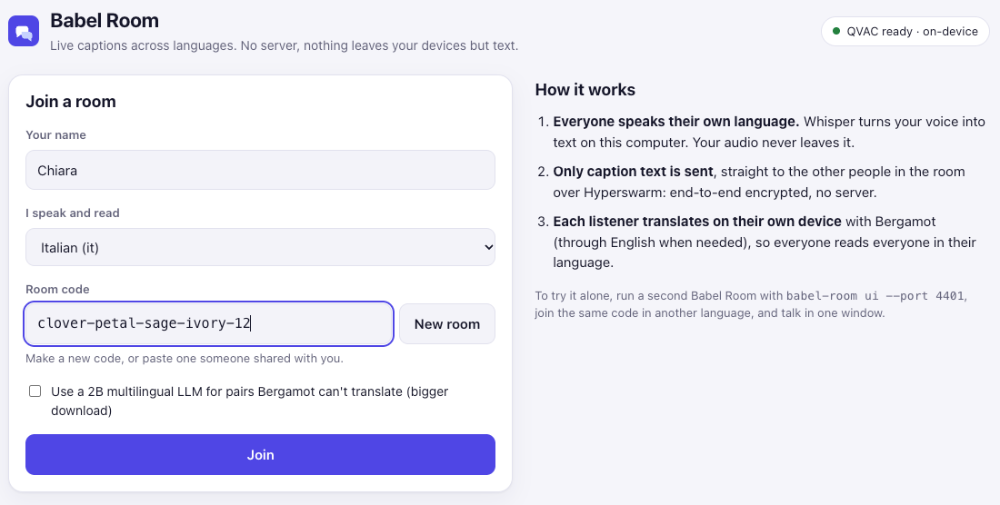
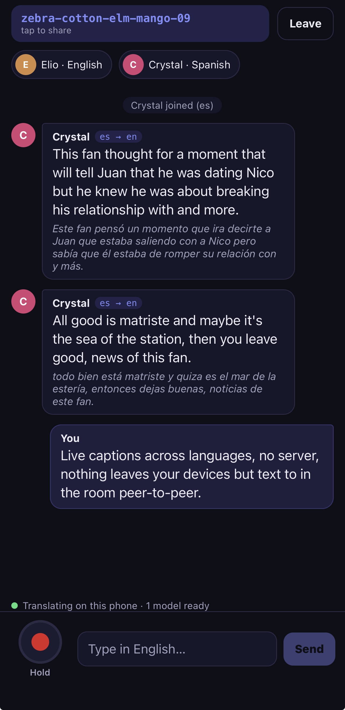
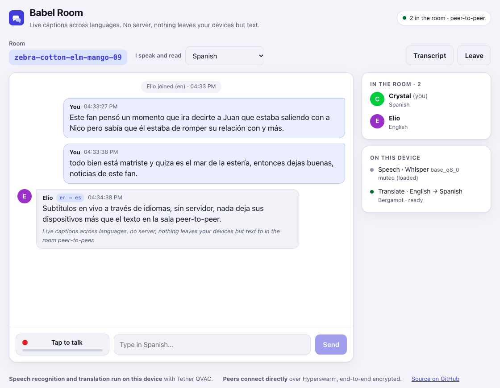

# Babel Room

**Live captions across languages, with no server.** Everyone in the room speaks their own language, and everyone reads everyone else in theirs. Speech recognition and translation run on each person's own device with [Tether QVAC](https://docs.qvac.tether.io/). Peers connect directly over [Hyperswarm](https://github.com/holepunchto/hyperswarm).

```console
$ babel-room new
petal-hollow-tern-bloom-23

# Ana, in Madrid                                    # Ben, in Berlin
$ babel-room join petal-hollow-tern-bloom-23 \      $ babel-room join petal-hollow-tern-bloom-23 \
    --name Ana --lang es --mic                          --name Ben --lang de --mic

                                                    • Ana joined (es)
  (Ana says) "Hola a todos, empezamos la reunión."  12:43:56 Ana [es→de]: Hallo zusammen, wir haben das Treffen begonnen.
                                                    12:43:58 Ana [es→de]: Hörst du mir gut zu?
```

## How it works

```
 Ana's laptop                                         Ben's laptop
 ┌───────────────────────────┐                        ┌────────────────────────────┐
 │ mic ─▶ Whisper + VAD (es) │   "Hola a todos…"      │ Bergamot es→en→de (pivot)  │
 │        │                  │ ─────────────────────▶ │        │                   │
 │        ▼                  │  text only, Noise-     │        ▼                   │
 │   your captions           │  encrypted, P2P        │ "Hallo zusammen…"          │
 └───────────────────────────┘                        └────────────────────────────┘
```

- **Audio never leaves your device.** Only caption *text* goes to peers.
- **Each listener translates on their own device into their own language.** Ana doesn't need German models, and a room of five languages doesn't need one person who can run them all.
- **No server.** The room code is hashed into a Hyperswarm topic. Peers find each other on the DHT, hole-punch NATs and talk over end-to-end encrypted streams.
- **Any pair, small models.** Bergamot models are about 15–40 MB per direction. Pairs that don't involve English go through English with QVAC's built-in `pivotModel`. For pairs Bergamot can't do, add `--llm` to fall back to a 2B multilingual LLM (SalamandraTA).
- **Memory check before download.** Whisper and the optional LLM are checked with QVAC's `assessModelFit()` before downloading, and a load that likely won't fit is refused (`--force` overrides). Bergamot models are a few tens of MB and can only be sized once on disk.
- **Speech recognition** uses Whisper with Silero VAD. Where QVAC ships a dedicated model for your language (es, fr, de, it, pt, ru, ja, nb) it uses that, otherwise the multilingual model. Known Whisper hallucinations ("Thank you.", "[No speech detected]") are filtered out.

## Install

```bash
npm install -g qvac-babel-room          # puts `babel-room` on your PATH
npm install qvac-babel-room   # library
```

From source: `git clone https://github.com/lopeselio/qvac-babel-room && cd qvac-babel-room && npm install`.

Requirements: Node.js 22+, and [ffmpeg](https://ffmpeg.org/) for microphone or file input. Models download on first use and are cached.

## Usage

```
babel-room new                                  print a fresh room code
babel-room join <code> --lang <xx> [options]    join a room
babel-room languages                            list supported languages
babel-room ui [--port 4400] [--no-open]         the web UI (see below)
```

| Option | |
|---|---|
| `--lang xx` | The language you speak and want to read (ISO 639-1) |
| `--name` | Display name |
| `--mic` | Caption your microphone. On macOS, grant your terminal microphone access. `--device ":1"` picks another input (`ffmpeg -f avfoundation -list_devices true -i ""`) |
| `--file audio.wav` | Caption an audio file at real-time speed (demos, testing) |
| `--asr tiny\|base\|small` | Whisper size (default `base`, 82 MB) |
| `--llm` | Allow the LLM fallback for pairs without a Bergamot route |
| `--transcript notes.md` | Append a Markdown transcript, with originals next to translations |
| `--original` | Also show the original text under each translated line |
| `--force` | Load models even if the memory check says they likely won't fit |

You can always type instead of speaking. In-room commands: `/lang <xx>`, `/peers`, `/mute`, `/unmute`, `/quit`.

## Web UI

```bash
npm start                    # or: babel-room ui [--port 4400] [--no-open]
```

`babel-room ui` opens a local web page with the same room as the CLI. Each person runs their own:

- **Join:** pick a name and the language you speak and read, then make a room code or paste one.
- **Talk or type:** **Tap to talk** captures the microphone in the browser and sends it to the local server, where QVAC Whisper (with voice activity detection) turns it into captions. You can type instead.
- **Read everyone in your language:** each caption shows its route (`es → en`, or `es → en → it` when Bergamot pivots through English), with the original underneath.
- **See the room:** a side panel lists the people in the room and the models on this device, with download progress.
- **Transcript:** download the conversation as Markdown, originals next to translations.

The server listens on 127.0.0.1 only, checks the Host header, serves a strict Content-Security-Policy and only accepts JSON or raw-audio POSTs. Audio goes no further than that local server; only caption text reaches peers.

To try it on one computer, run two or three with different ports, join the same code in different languages, and talk or type in one window:

```bash
babel-room ui --port 4400   # Ana, Spanish
babel-room ui --port 4401   # Ben, English
babel-room ui --port 4402   # Chiara, Italian
```

| Chiara reads Italian (Spanish arrives through English) | Ana reads Spanish |
|---|---|
|  |  |

| Ben reads English | Joining a room |
|---|---|
|  |  |

Results from three Babel Room servers on one Mac (Spanish, English and Italian) over the public Hyperswarm network, with real QVAC models:

- **No server in between.** The three peers found each other on the DHT from the room code and connected directly.
- **Speech to captions on-device.** A spoken Spanish sentence, streamed to Ana's server as microphone audio, came out of Whisper (multilingual base) as "Hola a todos, empezamos la reunión en 5 minutos. ¿Me escucháis bien?".
- **Each listener translates for themselves.** Ben read it as "Hello everyone, we started the meeting in 5 minutes. Do you listen to me well?" and Chiara in Italian, without Ana having any English or Italian model.
- **Any pair through English.** Spanish ↔ Italian has no Bergamot model, so QVAC chained es → en → it (and it → en → es) inside one loaded model.
- **Ready in seconds.** Every peer had its translation models downloaded and loaded 12 s after joining. Afterwards each line appeared on the other screens within a few seconds of being said or sent.
- **Models load one at a time.** With three languages, two routes need the same file (en → it directly, and es → it through it). Loading them in parallel failed in QVAC's model cache ("File descriptor could not be locked"), so the translator now loads models one after another.

## Mobile app

[`mobile/`](mobile/) is an Expo app for iPhone and Android:

- **Talk and read:** hold to talk, and read everyone in your language.
- **Same rooms everywhere:** it runs the same `Room` class as the CLI and the web UI, inside a Bare worklet, so a phone, a laptop and a terminal can all share one room code.
- **On the phone:** QVAC Whisper and Bergamot run on the device.

Build and run instructions are in [mobile/README.md](mobile/README.md).

| iPhone (English) | Web UI on a Mac (Spanish) |
|---|---|
|  |  |

The screenshots show one room, `zebra-cotton-elm-mango-09`, with an iPhone 13 Pro Max and the web UI on a Mac:

- **Phone ↔ laptop in one room.** The room code was created on one side and joined from the other. Each side listed the other within seconds.
- **Each side translates for itself.** The phone translated Crystal's Spanish into English with Bergamot on the iPhone ("Translating on this phone · 1 model ready"). The Mac translated Elio's English into Spanish.
- **Speech stays local.** Crystal's lines were spoken into the web UI and transcribed by Whisper on the Mac; only the text reached the phone.
- **Hold to talk works on the iPhone.** Speech recorded on the phone was transcribed by QVAC Whisper on the iPhone, then said in the room and translated on the other side.
- **Casual speech is harder.** Whisper base made mistakes on fast, casual Spanish ("matriste", "estería"), and Bergamot translated those words as they came. Clear speech, or the `--asr small` model on a laptop, gives cleaner captions.

## Library

```js
import * as sdk from '@qvac/sdk'
import { Room, Translator, Captioner, BabelSession } from 'qvac-babel-room'

const room = new Room({ code: 'petal-hollow-tern-bloom-23', name: 'Ben', lang: 'de' })
const session = new BabelSession({
  room,
  translator: new Translator({ sdk, target: 'de' }),
  captioner: new Captioner({ sdk, lang: 'de' })
})
session.on('line', (l) => console.log(`${l.name}: ${l.text}`))
await room.join()
await session.captioner.start()
```

Each piece is usable alone. `Translator` is a small, cached, any-to-any on-device translation service. `Captioner` turns a mic or file into an event stream of utterances.

## Security & privacy

- The room code is the only key, and anyone who has it can join. `babel-room new` generates about 38 bits (4 words + 2 digits), which is fine for a live meeting. Use a longer code for anything sensitive.
- The DHT only sees a SHA-256 of the code, never the code itself.
- Peers are untrusted. Every message is size-capped, schema-validated and rate-limited, and terminal control characters and bidi overrides are stripped before display.
- The peers you connect to can see your IP address.

## Development

```bash
npm test        # protocol, translator routing, captioner, session, the web UI server, plus a 4-peer room test on a local DHT testnet
npm run build:ui   # builds the React UI into ui/dist (npm start serves it)
npm run dev:ui     # hot-reloading UI against a running `babel-room ui` on port 4400
```

Tested end to end on macOS (Apple Silicon). Spanish speech was captioned by Whisper-base, then translated es→en→de on the receiving peer over the public Hyperswarm DHT. After the first model download, translations take about 100 ms per sentence.

## License

Apache-2.0
