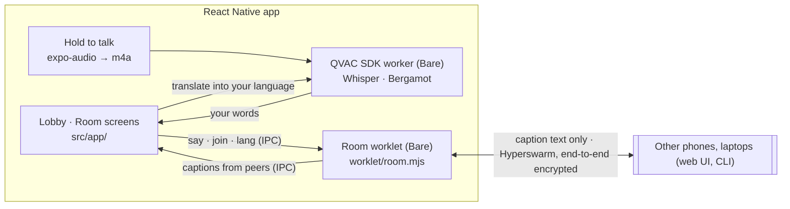

# Babel Room mobile

The Babel Room room on your phone: **hold to talk, read everyone in your language.** Built with Expo (SDK 54), [Tether QVAC](https://docs.qvac.tether.io/) and [Bare](https://github.com/holepunchto/bare). Phones, laptops running the [web UI](../README.md#web-ui) and the CLI all join the same rooms.

## How it's put together



- **The room runs in a Bare worklet.** It's the same `Room` class the CLI and the web UI use (`../src/room.js`), bundled with `bare-pack`. Hyperswarm needs native UDP and crypto (`udx-native`, `sodium-native`), so it runs in Bare, the way Holepunch's own apps do, and talks to React Native over BareKit IPC as newline-delimited JSON.
- **QVAC runs in its own worker.** Whisper transcribes your recording (QVAC decodes the m4a with its own FFmpeg) and Bergamot translates incoming captions into your language, through English when a pair has no direct model. The translator is Babel Room's own `../src/translator.js`, which Metro bundles.
- **Only caption text crosses the network.** Your audio is deleted once it's transcribed.

## Run on an iPhone

Requirements:

- A physical device: QVAC needs one.
- Node `^22.21.0` or `>=24.9.0` (`nvm use`): QVAC's and Bare's bundlers require it.
- Xcode.

```bash
cd mobile
nvm use
npm install
npm run prebuild     # bundles the room worklet, then expo prebuild (links QVAC's and the worklet's native addons)
open ios/BabelRoom.xcworkspace
```

In Xcode:

1. Pick your Personal Team under Signing & Capabilities.
2. Choose your iPhone and the **Release** configuration.
3. Press ⌘R.

On first launch, trust the developer profile under Settings → General → VPN & Device Management.

To have someone to talk to, run `npm start` in the repository root on a laptop. That opens the web UI: join the same room code there in another language.

### Things worth knowing

- **Xcode 27** needs the UIScene life cycle. `plugins/with-ios-scene-lifecycle.js` adds it at prebuild, the same plugin as Pocket Tune mobile.
- **Two Bare worklets, one addon folder.** QVAC's Expo plugin replaces react-native-bare-kit's linked addons with its own set. `plugins/with-room-worklet.js` runs as a finalized mod, after it, and links the room worklet's addons as well.
- **iPhone Mirroring turns the phone's microphone off for apps.** Hold to talk with the phone in your hand. The app tells you when it only heard silence.

## Checks

```bash
npm test           # IPC framing (UTF-8 split across chunks), room codes, route labels
npm run typecheck
npm run lint
npm run worklet    # bundles worklet/room.mjs for iOS and Android hosts
```
